# Fundoo Notes — Frontend

A polished, responsive React single-page application for the
[Fundoo Notes Spring Boot backend](https://github.com/Dheeraj-999/FundooNotes).
It turns the backend's REST API into a Google Keep-style workspace for capturing,
organising, labelling, scheduling and importing personal notes.

> **This branch is documentation only.** The application source, tests and build
> configuration live on [`develop`](https://github.com/Dheeraj-999/FundooNotes_Frontend/tree/develop).

---

## Table of contents

1. [Introduction](#1-introduction)
2. [Features](#2-features)
3. [Technology stack](#3-technology-stack)
4. [Architecture and data flow](#4-architecture-and-data-flow)
5. [Screenshots](#5-screenshots)
6. [Project structure](#6-project-structure)
7. [Getting started](#7-getting-started)
8. [Available scripts](#8-available-scripts)
9. [Backend API contract](#9-backend-api-contract)
10. [Authentication and security](#10-authentication-and-security)
11. [Testing and quality](#11-testing-and-quality)
12. [Branching strategy](#12-branching-strategy)
13. [Known limitations](#13-known-limitations)
14. [Future enhancements](#14-future-enhancements)
15. [Related repositories](#15-related-repositories)

---

## 1. Introduction

**Fundoo Notes Frontend** is the browser client for a distributed note-management
system. It provides a secure, fast and friendly interface over a Java 21 / Spring Boot
API that handles authentication, note lifecycles, labels, reminders, caching,
messaging and batch imports.

The application covers the complete user journey:

- create an account and sign in with a JWT;
- recover a forgotten password through an emailed one-time code;
- write notes, pin the important ones, archive or trash the rest;
- search and filter instantly on the client;
- group notes with custom, user-specific labels;
- schedule reminders and receive both browser and email alerts;
- bulk-import notes from an Excel workbook.

Every screen is built around explicit loading, empty, error and success states, and
the UI never pretends a capability exists when the backend does not provide it.

---

## 2. Features

### Authentication and account recovery

| Feature | Behaviour |
| --- | --- |
| Registration | Controlled form with client-side validation; on success the app automatically signs the user in. |
| Login | Calls the backend, stores the JWT in `localStorage` and redirects to the dashboard. |
| Protected routes | Unauthenticated visitors are redirected to `/login`; the token is sent on every API request. |
| Logout | Clears the stored token and returns to the login screen. |
| Forgot password | Emailed 6-digit OTP flow with a confirmation step and a link to the reset screen. |
| Reset password | Verifies the code, confirms the new password and shows a success state. |

### Notes and organisation

- **Dashboard** with an inline note editor (title and description) and a responsive card grid.
- **Search** across titles and descriptions, with instant client-side results.
- **Filter chips** for all, pinned and labelled notes, with live counts.
- **Pin / archive / trash** toggles on every note card.
- **Edit notes**: click the pencil icon on any active or archived note to change its title and description in a dialog.
- **Archive view** with unarchive and delete actions.
- **Trash view** with restore and a confirmed **Delete forever** action that permanently removes the note.
- **Labels**: create, rename and delete labels; assign or remove labels on a note; browse notes by label.
- **Empty states** with helpful calls to action instead of blank screens.

### Reminders

- Create, edit and delete a reminder on any active note, with future-date validation.
- Sorted upcoming list showing note title and formatted local date/time.
- **Browser alerts** while the tab is open: in-app toast, desktop notification and a short chime.
- **Enable browser alerts** control plus a **Test alert** button on the Reminders page.
- **Email backup** from the backend scheduler every 30 seconds, so a reminder still arrives when the browser is closed. Each due reminder is emailed exactly once and failed sends are retried.
- Rescheduling a reminder re-arms both the browser alert and the email.

### Import and polish

- Excel (`.xlsx`) upload with multipart `file` field, progress and result states.
- Loading spinners, inline field errors, toast notifications and success confirmations throughout.
- Responsive layout with a collapsible sidebar on smaller screens.
- Accessible forms with labels, keyboard-friendly controls and semantic dialogs.
- Dynamic document titles per route.

---

## 3. Technology stack

| Layer | Choice |
| --- | --- |
| UI library | React 19 |
| Build tool | Vite 7 |
| Routing | React Router 6 |
| HTTP client | Axios (single configured instance with auth interceptor) |
| Styling | Hand-written CSS design system (tokens, components, responsive rules) |
| Icons | Lucide React |
| Testing | Vitest 3, React Testing Library, user-event, jsdom |
| Language | JavaScript (ES modules) |
| Runtime | Node.js 20.19+ (Node 22 recommended) |

No CSS framework, component library or state-management dependency is required —
the interface is intentionally lightweight and easy to audit.

---

## 4. Architecture and data flow

```
Browser
  │
  ▼
React Router  ──►  ProtectedRoute  ──►  AppLayout (shared shell)
  │                                       │
  │                                       ├─ useNotes()     ──► noteService
  │                                       ├─ useLabels()    ──► labelService
  │                                       ├─ useReminders() ──► reminderService
  │                                       └─ useReminderAlerts()
  │                                                            │
  │                                                            ▼
  └────────────────────────────  apiClient  ──►  /api/*  ──► Spring Boot :8080
                                    │
                                    └─ Authorization: Bearer <JWT>
```

Key conventions:

- **API calls live only in `src/services/`.** Hooks own loading/error state and keep
  the list in sync after mutations; pages and components stay presentational.
- **`apiClient` is the single Axios instance.** It owns the `/api` base URL and adds
  the bearer token automatically.
- **`GET /notes` returns active, archived and trashed notes together.** The client
  filters by `archived` / `trashed` locally; search is client-side for the same reason.
- **Pin, archive and trash are toggles.** The UI never sends a desired boolean state.
- **The dev server proxies `/api` to `:8080`**, so there are no CORS problems locally.
  Set `VITE_API_BASE_URL` for a hosted backend and allow that origin in the backend CORS config.

---

## 5. Screenshots

Captured from the running application with representative sample data.

### Authentication

| Login | Registration |
| --- | --- |
| 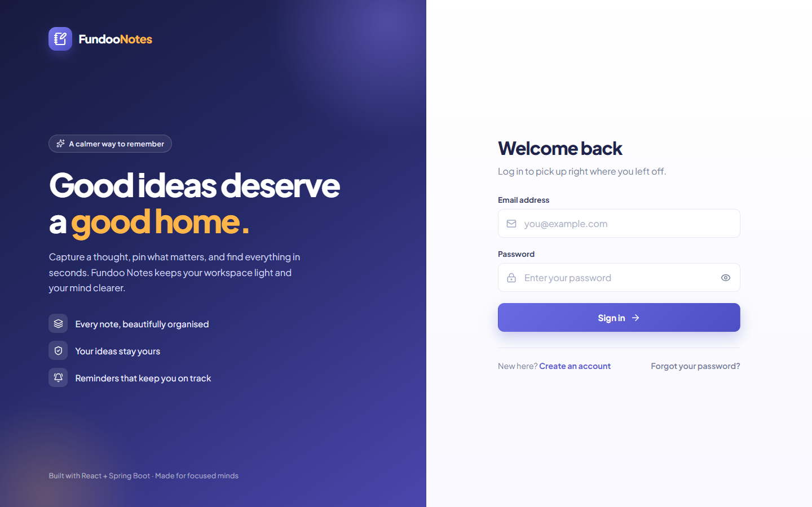 | 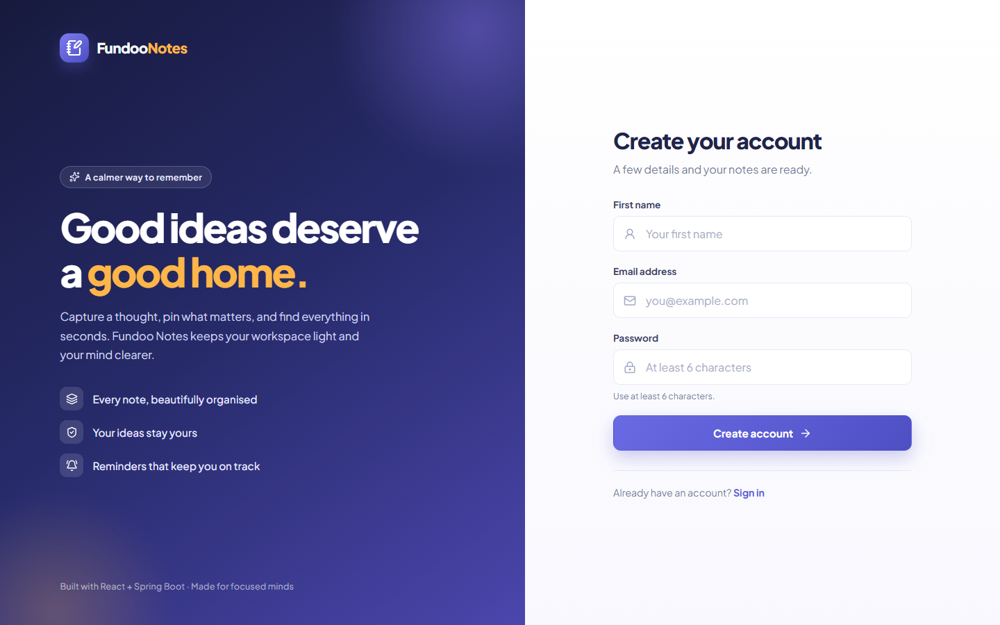 |

| Forgot password | Password reset |
| --- | --- |
| 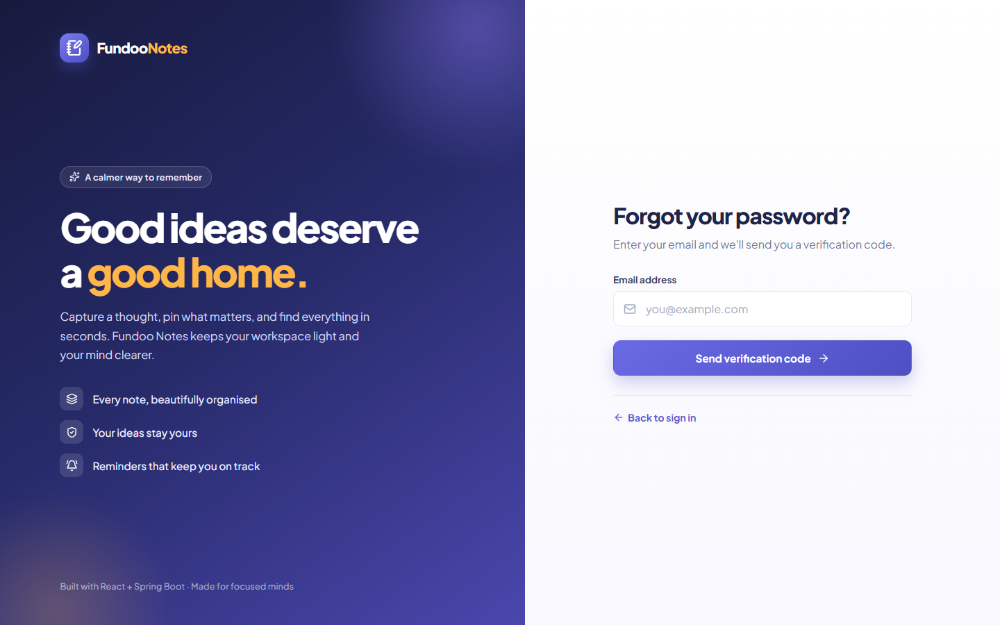 | 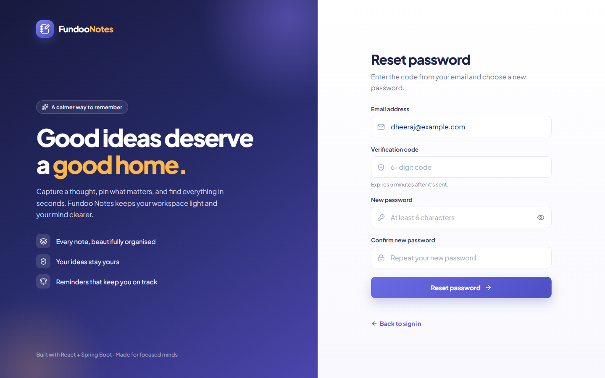 |

### Workspace

| Dashboard | Archive |
| --- | --- |
| 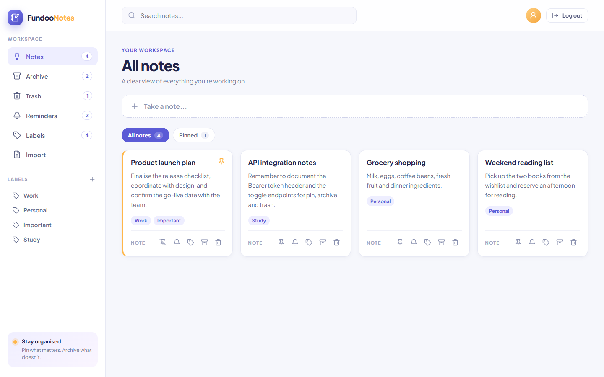 | 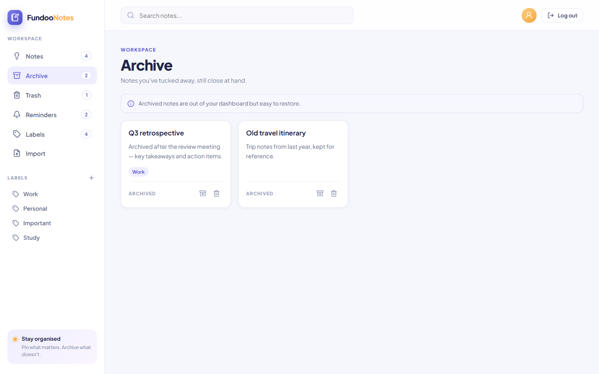 |

| Trash | Labels |
| --- | --- |
| 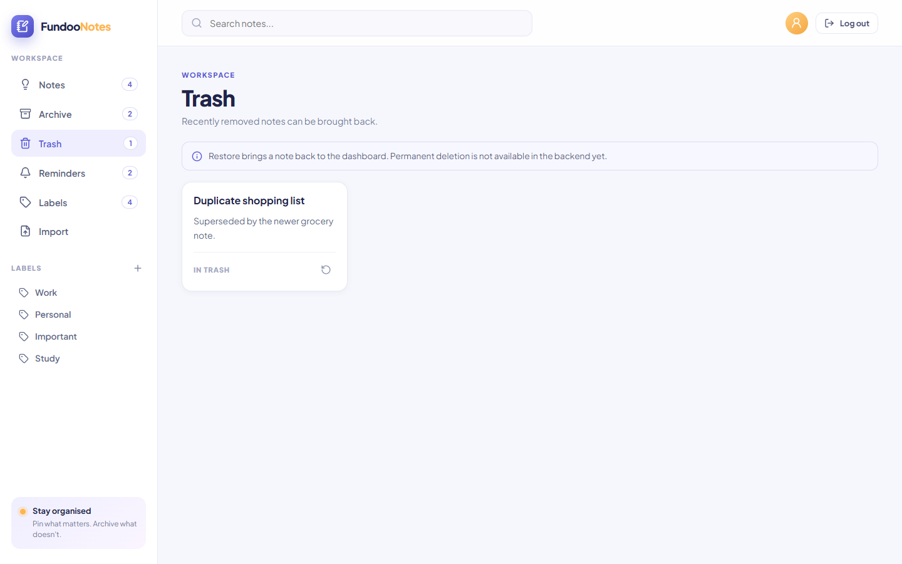 | 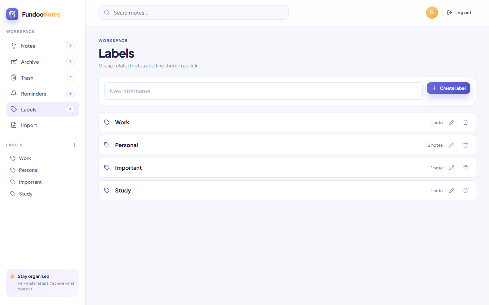 |

| Reminders | Excel import |
| --- | --- |
| 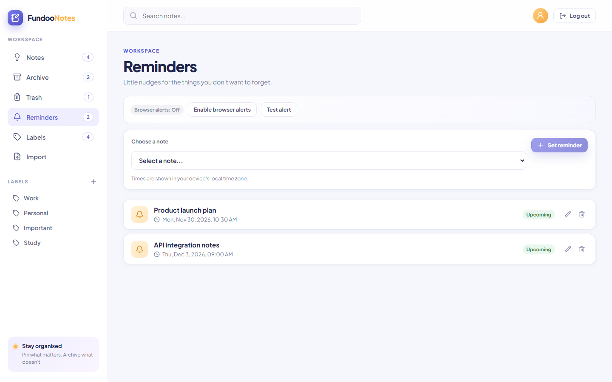 | 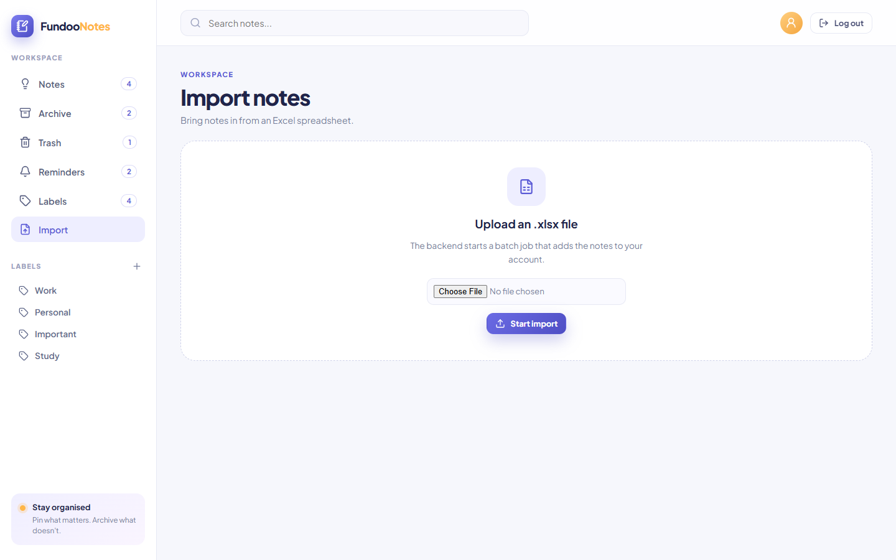 |

### Editing and permanent deletion

| Edit note dialog | Delete confirmation |
| --- | --- |
| 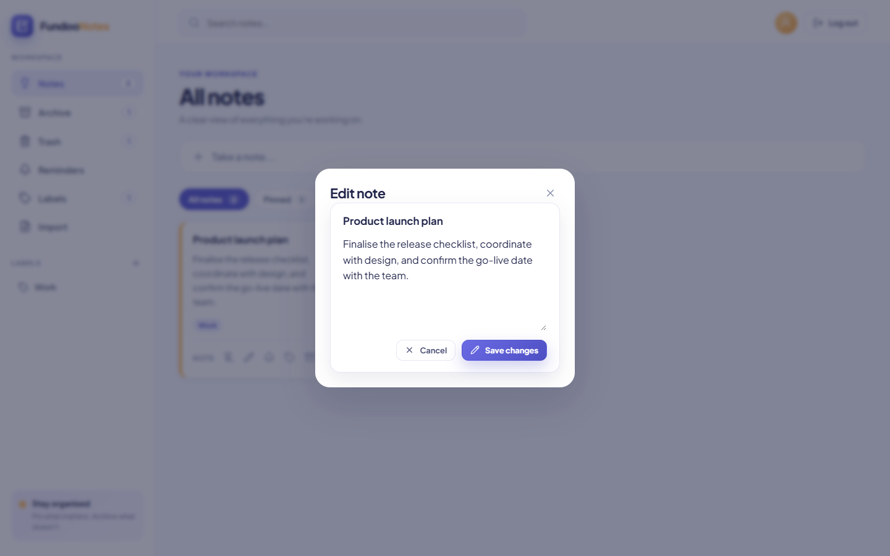 | 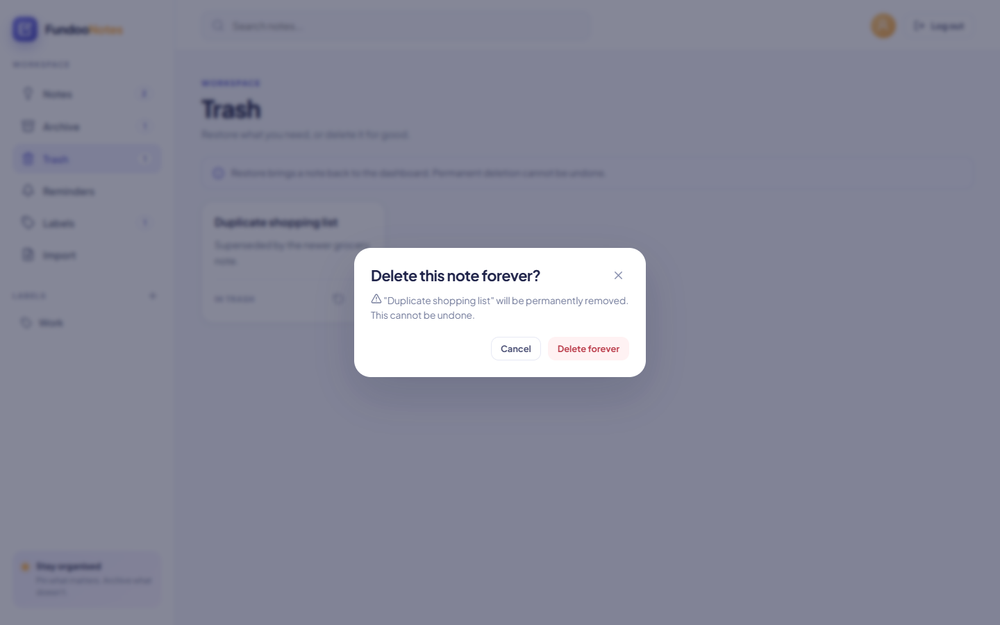 |

---

## 6. Project structure

```
FundooNotes_Frontend/
├── docs/
│   └── screenshots/            UI screenshots used in this README
│       ├── 01-login.png
│       ├── 02-register.png
│       ├── 03-forgot-password.png
│       ├── 04-dashboard.png
│       ├── 05-archive.png
│       ├── 06-trash.png
│       ├── 07-labels.png
│       ├── 08-reminders.png
│       ├── 09-import.png
│       ├── 10-reset-password.png
│       ├── 11-edit-note.png
│       └── 12-delete-confirmation.png
├── index.html                  Vite entry document
├── package.json                Scripts and dependencies
├── vite.config.js              React plugin, dev proxy and Vitest config
├── .env.example                Optional API base URL override
└── src/
    ├── main.jsx                Application bootstrap
    ├── App.jsx                 Providers (router, auth, toast)
    ├── router/
    │   └── AppRoutes.jsx       Public and protected route definitions
    ├── pages/
    │   ├── LoginPage.jsx
    │   ├── RegisterPage.jsx
    │   ├── ForgotPasswordPage.jsx
    │   ├── ResetPasswordPage.jsx
    │   ├── DashboardPage.jsx
    │   ├── ArchivePage.jsx
    │   ├── TrashPage.jsx
    │   ├── LabelPage.jsx
    │   ├── RemindersPage.jsx
    │   └── ImportPage.jsx
    ├── components/
    │   ├── AppLayout.jsx       Shared shell: sidebar, navbar and reminder dialog
    │   ├── AuthLayout.jsx      Shared auth screen layout
    │   ├── ProtectedRoute.jsx  JWT route guard
    │   ├── SearchBar.jsx
    │   ├── FilterBar.jsx
    │   ├── NoteEditor.jsx
    │   ├── NoteCard.jsx
    │   ├── NoteList.jsx
    │   ├── LabelModal.jsx
    │   ├── ReminderModal.jsx
    │   ├── EmptyState.jsx
    │   ├── Toast.jsx
    │   ├── Navbar.jsx
    │   ├── Brand.jsx
    │   └── Sidebar.jsx
    ├── hooks/
    │   ├── useAuth.jsx
    │   ├── useNotes.js
    │   ├── useLabels.js
    │   ├── useReminders.js
    │   └── useReminderAlerts.js
    ├── services/
    │   ├── authService.js
    │   ├── noteService.js
    │   ├── labelService.js
    │   ├── reminderService.js
    │   └── importService.js
    ├── utils/
    │   ├── apiClient.js
    │   ├── token.js
    │   ├── validators.js
    │   ├── dateTime.js
    │   ├── noteFilters.js
    │   ├── notifications.js
    │   ├── errors.js
    │   └── pageTitles.js
    ├── styles/
    │   └── global.css          Tokens, components, responsive rules
    └── test/
        └── setup.js            Vitest / Testing Library setup
```

Most folders contain a `__tests__/` directory with co-located unit and component
tests, mirroring the source layout.

---

## 7. Getting started

### Prerequisites

- **Node.js 20.19+** (Node 22 recommended) and npm
- **Backend** running at `http://localhost:8080`
- Backend dependencies: MySQL, Redis, ActiveMQ and RabbitMQ
- SMTP credentials on the backend for password reset and reminder emails

### Install and run

```bash
git checkout develop
npm install
cp .env.example .env.local   # optional — defaults already target the local backend
npm run dev
```

Open **http://localhost:5173**. Registration, login and the dashboard require the
backend to be reachable through the dev proxy.

### Environment

| Variable | Default | Purpose |
| --- | --- | --- |
| `VITE_API_BASE_URL` | `/api` | API base URL; change only when the backend is hosted elsewhere |

SMTP credentials are **never** stored in the frontend. They are backend environment
variables (`APP_MAIL_USERNAME`, `APP_MAIL_PASSWORD`, `APP_MAIL_FROM`).

### Production build

```bash
npm run build     # outputs dist/
npm run preview   # serve the production build locally
```

---

## 8. Available scripts

| Script | Description |
| --- | --- |
| `npm run dev` | Start the Vite dev server on port 5173 |
| `npm run build` | Create an optimised production build in `dist/` |
| `npm run preview` | Preview the production build |
| `npm test` | Run the full Vitest suite once |
| `npm run test:watch` | Watch mode for test-driven development |
| `npm run check` | Run all tests **and** a production build — the release gate |

---

## 9. Backend API contract

All paths are relative to `/api`. Responses are JSON; errors follow
`{ timestamp, status, error, message, path, validationErrors }`.

| Feature | Endpoints used by the UI |
| --- | --- |
| Authentication | `POST /users/register`, `POST /users/login` |
| Password recovery | `POST /users/forgot-password`, `POST /users/reset-password` |
| Notes | `GET /notes`, `POST /notes`, `PUT /notes/{id}`, `DELETE /notes/{id}`, `PATCH /notes/{id}/pin`, `PATCH /notes/{id}/archive`, `PATCH /notes/{id}/trash` |
| Labels | `GET /labels`, `POST /labels`, `PUT /labels/{id}`, `DELETE /labels/{id}`, `POST /labels/{labelId}/notes/{noteId}`, `DELETE /labels/{labelId}/notes/{noteId}` |
| Reminders | `GET /reminders`, `POST /reminders`, `PUT /reminders/{id}`, `DELETE /reminders/{id}` |
| Excel import | `POST /batch/import/notes` (multipart field `file`, `.xlsx` only) |

Representative payload shapes:

```js
// Login response
{ token: "eyJ...", message: "Login successful" }

// Note
{ id: 1, title: "Launch plan", description: "...", pinned: true,
  archived: false, trashed: false, labels: [{ id: 2, name: "Work" }] }

// Reminder
{ id: 5, noteId: 1, noteTitle: "Launch plan", reminderTime: "2026-11-30T10:00:00" }

// Import response
{ message: "Import started", executionId: 42, status: "STARTED" }
```

Reminder times are local `LocalDateTime` strings without a timezone suffix.

Editing uses the same `{ title, description }` payload as creation. Permanent deletion
is accepted only for notes already in trash; the backend removes dependent reminders
and label links first so no orphaned rows remain.

---

## 10. Authentication and security

- The JWT is stored under the `localStorage` key `token`.
- `apiClient` attaches `Authorization: Bearer <token>` to every request.
- Registration returns `{ id, firstName, email }` and **no token**, so the app follows it with a login request.
- `ProtectedRoute` checks the token before rendering the application shell.
- The password-reset code is generated and stored in Redis with a 5-minute TTL, emailed over SMTP and never returned in an API response. Unknown emails receive the same generic response as known ones.
- The old `/api/redis/otp/*` debug endpoints were removed from the backend because they exposed the code in HTTP responses.

---

## 11. Testing and quality

```bash
npm run check
```

Current result: **34 test files, 85 tests passing**, followed by a successful
`vite build` (~1778 modules transformed).

Coverage includes:

- service layers with mocked Axios responses;
- hooks for loading, error, mutation and alert-firing behaviour;
- page-level flows such as registration, login, password reset, import and reminder editing;
- modal validation, filters, token helpers, date parsing and browser-notification helpers;
- route protection and error-message mapping.

Vitest runs with two workers and a 15-second timeout to keep jsdom tests stable on
Windows.

---

## 12. Branching strategy

| Branch | Purpose |
| --- | --- |
| `main` | Documentation only — this README and the screenshots. |
| `develop` | Integration branch containing the complete application. |
| `feature/*` | One branch per use case, merged into `develop` without fast-forward. |
| `fix/*` | Small corrective changes, also merged into `develop`. |

### Feature history

| Branch | Commit | Use case |
| --- | --- | --- |
| `feature/project-setup` | `08c5774` | Vite/React scaffold, API client, utilities and design system |
| `feature/auth-flow` | `bac0ce6` | Register, login, JWT storage and protected routes |
| `feature/dashboard-notes` | `bbe9cb7` | Dashboard shell, note creation, pin/archive/trash |
| `feature/archive-trash` | `dfbf30b` | Archive and trash views with restore actions |
| `feature/labels` | `1227650` | Label CRUD, assignment, modal and filtered view |
| `feature/reminders` | `9691864` | Create, edit and delete note reminders |
| `feature/import-polish` | `4ba29c2` | Excel upload flow and accessibility polish |
| `feature/password-reset` | `5c36e5b` | Email OTP password recovery |
| `feature/reminder-alerts` | `b58c9c2` | Browser notifications, chime and alert settings |
| `fix/reminder-alert-reschedule` | `20444f8` | Re-arm browser alerts after editing a reminder |
| `feature/note-edit-delete` | `c412a77` | Edit notes and permanently delete from trash |

To work on the application:

```bash
git checkout develop
git pull origin develop
git checkout -b feature/<use-case>
```

---

## 13. Known limitations

These are deliberate boundaries of the current backend API, not UI bugs:

- Search and pagination are client-side; the backend has no filter/search endpoint.
- Note colours, collaborators and attachments are not available.
- Logout clears the local token but does not blacklist it server-side.
- Browser notifications require permission and only fire while the app is open; the email backup requires the backend to stay online and SMTP to be configured.

See `BACKEND_NOTES.md` on `develop` for recommended API additions.

---

## 14. Future enhancements

- Server-side search, filtering and pagination.
- Note revision history and permanent deletion endpoints.
- Collaborative notes with shared labels.
- Push notifications for mobile devices.
- Rich-text notes and file attachments.
- User-configurable reminder lead time and quiet hours.

---

## 15. Related repositories

| Repository | Description |
| --- | --- |
| [FundooNotes (backend)](https://github.com/Dheeraj-999/FundooNotes) | Java 21 / Spring Boot REST API with JWT, Redis, RabbitMQ, ActiveMQ, Spring Batch and AOP |
| [FundooNotes_Frontend](https://github.com/Dheeraj-999/FundooNotes_Frontend) | This React/Vite client — use the `develop` branch for the source |

---

*Fundoo Notes Frontend — organised thoughts, beautifully delivered.*
